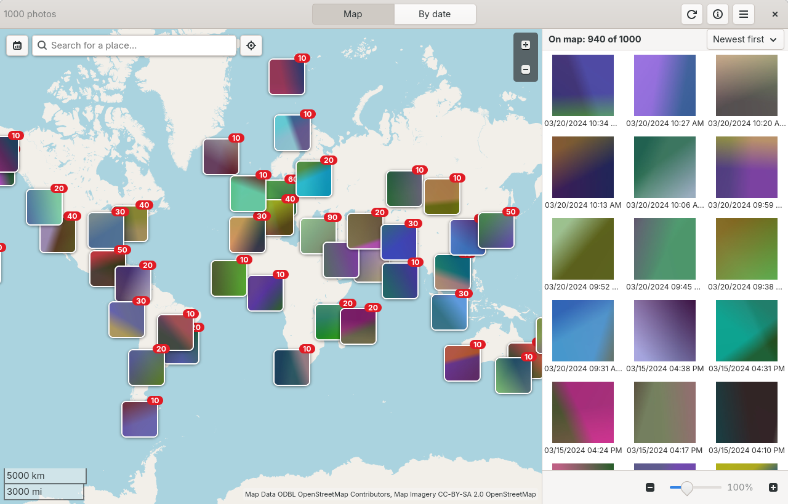

# Geo photo library

[Русский](README.md) | **English**

A photo catalog for Linux (Rust + GTK4 + SQLite) that places your photos on an OpenStreetMap
map using GPS coordinates from EXIF. macOS has a native interface (SwiftUI + MapKit) on top of
the same core, see [Building (macOS)](#building-macos).



## Features

- **Map** — photo previews on the map, clustered; on the right, the photos in the visible area
  sorted by date (newest or oldest first, the choice is remembered). The map position and zoom
  are remembered between launches.
- **Place search** — a search box above the map: type a city, address or landmark and press
  Enter (Nominatim geocoder, requires internet). Several matches are shown as a list.
- **My location** — a button next to the search box: the map jumps to your current location and
  marks it with a dot (via the location portal; location services must be enabled in the system
  settings).
- **By date** — a year → month → day tree and a thumbnail grid.
- **Information** — a panel on the right with file and EXIF data: camera, lens, shutter speed,
  aperture, ISO, focal length, coordinates, altitude and all tags. It follows the selected photo.
  Open it with the “i” button in the window header or from the photo menu; close it with the same
  button or the cross.
- **Photo menu** (right click): copy the file, view, edit, information, show on map (jumps to
  where the photo was taken; warns if EXIF has no coordinates), move to trash.
- Double click opens the photo in a viewer, Ctrl + double click in an editor. Both are chosen
  in Settings (by default, the app for the file type and a detected image editor).
- A slider under the photo grids scales thumbnails from 50 to 200%, with −/+ buttons (10% steps).
- On startup the library is rescanned incrementally (new, changed and deleted files).
- Formats: JPEG, HEIC/HEIF (iPhone, Samsung), PNG, WebP, TIFF, DNG (metadata only).
- Interface languages: English, Russian, Greek — from the system locale (`LANG`, `LC_MESSAGES`,
  `LANGUAGE`), English by default. Photo dates follow the system date format (`LC_TIME`),
  e.g. `12/21/2025 01:03 PM` in en_US and `21/12/25 13:03` in en_GB.

## Installation

GitHub Actions builds an RPM for Fedora 45 on every push to `main`: **Actions** tab → latest
**CI** run → `geo-photo-library-fc45-rpm` artifact.

```sh
sudo dnf install ./geo-photo-library-*.fc45.x86_64.rpm
```

A disk image for macOS (Apple silicon, macOS 14 or later) is built there too: the
`geo-photo-library-macos-dmg` artifact. The app is not signed with a developer certificate
and not notarized, so after dragging it to Applications remove the quarantine flag,
otherwise macOS will refuse to open it:

```sh
xattr -dr com.apple.quarantine "/Applications/Geo photo library.app"
```

## Building (Fedora)

```sh
sudo dnf install gcc gtk4-devel libshumate-devel libheif-devel
cargo run --release
```

Without HEIC: `cargo build --release --no-default-features`.

Scan without the GUI: `geo-photo-library --scan <folder>`.

Packages:

- `./packaging/build-rpm.sh` — RPM in `target/rpmbuild/RPMS/x86_64/`;
- `./packaging/flatpak/build-flatpak.sh` — Flatpak bundle `target/flatpak/geo-photo-library.flatpak`
  (the SDK goes into the user installation, no root needed).

## Building (macOS)

A native app: the Rust core (scanner, database, thumbnails) is built as a static library, the
interface is SwiftUI with a MapKit map (`macos/`). Requires Xcode and Rust (rustup); GTK and
libheif are not needed — HEIC is decoded by the system.

```sh
./macos/build-app.sh --run   # → target/macos/Geo photo library.app
./macos/build-dmg.sh         # → target/macos/Geo-photo-library-<version>-arm64.dmg
```

The features are the same as on Linux, with the differences customary on macOS:

- the map and place search are Apple's (MapKit) instead of OpenStreetMap and Nominatim;
- "My location" uses CoreLocation; the system asks for permission on first use;
- the Information panel — the "i" button in the title bar or ⌘I; rescan — ⌘R;
- editing — ⌘ + double-click; the photo menu also has "Show in Finder";
- settings (⌘,) apply immediately; the viewer and editor are chosen from the installed apps;
- the interface language and date format come from the system settings.

## Data

| What | Where |
| --- | --- |
| Settings (library folder, sorting, thumbnail size, map position, apps) | `~/.config/geo-photo-library/config.toml` |
| Database | `~/.local/share/geo-photo-library/library.db` |
| Thumbnails | `~/.cache/geo-photo-library/thumbs/` |

The Flatpak version keeps the same files separately, in `~/.var/app/io.github.EvilX.GeoPhotoLibrary/`.
On macOS the settings and database live in `~/Library/Application Support/geo-photo-library/`,
thumbnails in `~/Library/Caches/geo-photo-library/thumbs/`.

The network is used only for OpenStreetMap tiles and place search; your photos are never uploaded.
Your location is determined by the system (GeoClue) only when you press the button and is not stored.

## Development

- CI (`.github/workflows/ci.yml`): clippy and tests, then an RPM build — in a `fedora:45` container;
  on macOS — core tests and a DMG build.
- `GEO_PHOTO_LIBRARY_TRACE=1` — timing of UI operations.
- `cargo run --release --example bench_thumbs -- <folder>` — thumbnail generation benchmark.
- Instructions for AI agents and debug environment variables (in Russian) — [AGENTS.md](AGENTS.md).
