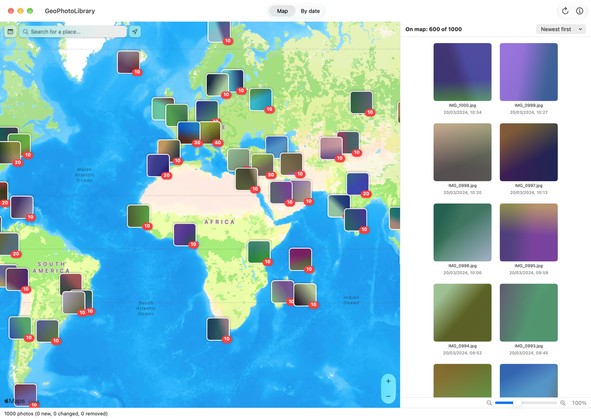
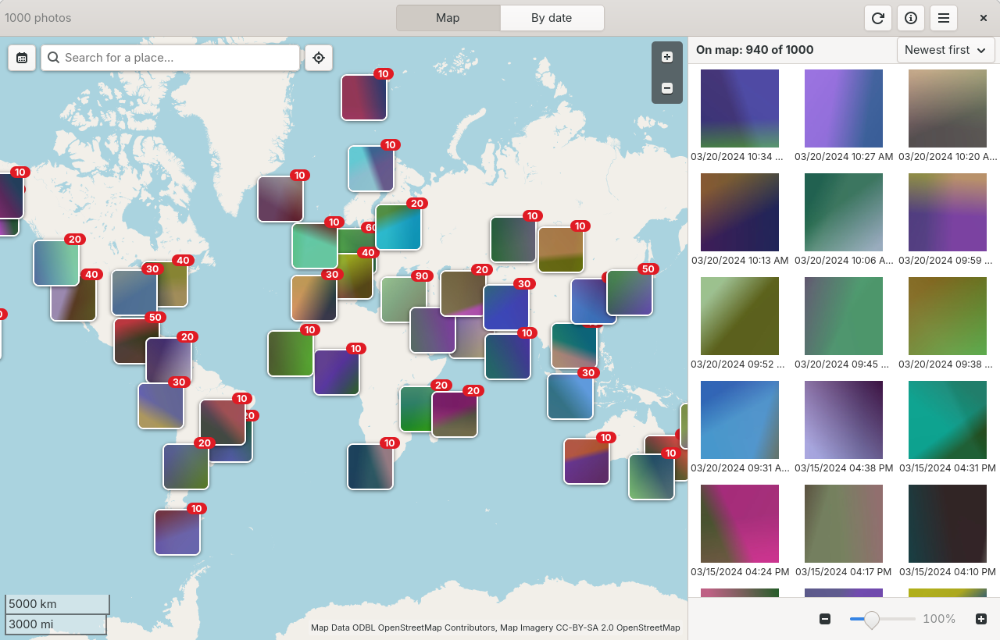
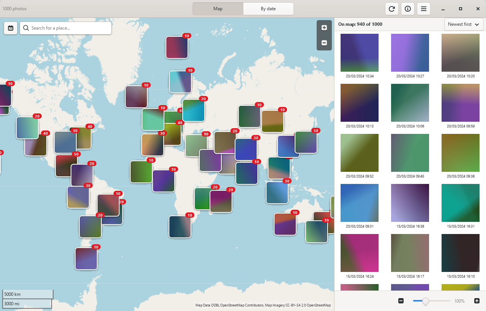

#  GeoPhotoLibrary

[Русский](README.ru.md) | **English**

[](https://github.com/EvilX/geo-photo-library/releases/latest)
[](https://github.com/sponsors/EvilX)

A photo catalog for Linux, Windows and macOS that places your photos on a map using GPS coordinates
from EXIF. The Rust core (scanner, SQLite database, thumbnails) is shared; the interface is
GTK4 with an OpenStreetMap map on Linux and Windows and a native SwiftUI one with a MapKit map on macOS
(see [Building (macOS)](#building-macos)).

The macOS version was added in 1.1; nothing has changed feature-wise on Linux since 1.0.


<p align="center"><em><b>macOS</b> — native SwiftUI app with Apple Maps</em></p>


<p align="center"><em><b>Linux</b> — GTK4 with an OpenStreetMap map</em></p>


<p align="center"><em><b>Windows</b> — the same GTK4 interface</em></p>

## Features

The description below is for Linux; the differences of the macOS version are listed in
[Building (macOS)](#building-macos).

- **Map** — photo previews on the map, clustered; on the right, the photos in the visible area
  sorted by date (newest or oldest first, the choice is remembered). The map position and zoom
  are remembered between launches.
- **Place search** — a search box above the map: type a city, address or landmark and press
  Enter (Nominatim geocoder, requires internet). Several matches are shown as a list.
- **My location** — a button next to the search box: the map jumps to your current location and
  marks it with a dot (via the location portal; location services must be enabled in the system
  settings).
- **Date filter** — the calendar button left of the search box opens a panel over the map with
  "All time" and a year → month → day tree; the map keeps only the photos of the chosen period
  while its position and zoom stay as they are. The chosen period is shown on the button; a click
  on the map closes the panel.
- **By date** — a year → month → day tree and a thumbnail grid.
- **Information** — a panel on the right with file and EXIF data: camera, lens, shutter speed,
  aperture, ISO, focal length, coordinates, altitude and all tags. It follows the selected photo
  and stays empty while several photos are selected.
  Open it with the “i” button in the window header or from the photo menu; close it with the same
  button or the cross.
- **Photo menu** (right click): copy the file, view, edit, show in folder (the file manager opens
  the folder with the file selected), information, show on map (jumps to
  where the photo was taken; warns if EXIF has no coordinates), move to trash (after confirmation).
- **Selecting several photos:** Ctrl + click (⌘ + click on macOS) adds or removes a photo,
  Shift + click selects a range, dragging a rectangle selects the photos under it, Ctrl+A (⌘A)
  selects all. For several photos the menu offers only Copy and Delete.
- **Keyboard in the photo list:** arrows, Page Up/Page Down, Home/End move between photos,
  with Shift they extend the selection.
- Double click opens the photo in a viewer, Ctrl + double click in an editor. Both are chosen
  in Settings (by default, the app for the file type and a detected image editor).
- A slider under the photo grids scales thumbnails from 50 to 200%, with −/+ buttons (10% steps).
- On startup the library is rescanned incrementally (new, changed and deleted files).
- **Update check:** on startup the app asks GitHub for the latest release
  (`api.github.com`); if it is newer, a bar above the tabs shows its version and a link to the
  [website](https://evilx.github.io/geo-photo-library/). Turned off in Settings
  («Check for updates at startup»).
- Formats: JPEG, HEIC/HEIF (iPhone, Samsung), PNG, WebP, TIFF, DNG (metadata only).
- Interface languages: English, Russian, Greek — from the system locale (`LANG`, `LC_MESSAGES`,
  `LANGUAGE`), English by default. Photo dates follow the system date format (`LC_TIME`),
  e.g. `12/21/2025 01:03 PM` in en_US and `21/12/25 13:03` in en_GB.

## Installation

The easiest way is the package repository: new versions then arrive with regular system updates.

Fedora 45 (x86_64 and aarch64):

```sh
sudo dnf config-manager addrepo --from-repofile=https://evilx.github.io/geo-photo-library/geo-photo-library.repo
sudo dnf install geo-photo-library
```

Ubuntu 24.04 and 26.04 (amd64 and arm64):

```sh
sudo install -d /etc/apt/keyrings
curl -fsSL https://evilx.github.io/geo-photo-library/key.gpg | sudo tee /etc/apt/keyrings/geo-photo-library.gpg > /dev/null
echo "deb [signed-by=/etc/apt/keyrings/geo-photo-library.gpg] https://evilx.github.io/geo-photo-library/deb $(. /etc/os-release && echo $VERSION_CODENAME) main" \
  | sudo tee /etc/apt/sources.list.d/geo-photo-library.list
sudo apt update && sudo apt install geo-photo-library
```

The same packages can also be downloaded and installed by hand — they are in the [latest release](https://github.com/EvilX/geo-photo-library/releases/latest):
RPMs for Fedora 45 (x86_64 and aarch64), DEBs for Ubuntu 24.04 and 26.04 (amd64 and arm64),
a disk image for macOS and installers for Windows.

```sh
sudo dnf install ./geo-photo-library-*.fc45.*.rpm                # Fedora
sudo apt install ./geo-photo-library_*~ubuntu24.04_amd64.deb     # Ubuntu: your release and architecture
```

Builds of the current `main` are made by GitHub Actions on every push: **Actions** tab → latest
**CI** run → the `geo-photo-library-fc45-rpm` (x86_64), `geo-photo-library-fc45-aarch64-rpm` (ARM),
`geo-photo-library-ubuntu<release>-<arch>-deb`, `geo-photo-library-macos-dmg` or `geo-photo-library-windows-<x64|arm64>`
artifact (downloading artifacts requires signing in to GitHub).

The macOS disk image is for Apple silicon, macOS 14 or later. The app is not signed with
a developer certificate and not notarized, so after dragging it to Applications remove the quarantine flag,
otherwise macOS will refuse to open it:

```sh
xattr -dr com.apple.quarantine "/Applications/GeoPhotoLibrary.app"
```

Windows 10 (1809) or 11, x64 or ARM64: run `GeoPhotoLibrary-<version>-<x64|arm64>-setup.exe`
from the release. It installs for the current user, without administrator rights, and adds
GeoPhotoLibrary to the Start menu; it is removed in Settings → Apps. The installer is not signed, so
SmartScreen may warn about it: **More info → Run anyway**. The `.zip` next to it is a portable version:
unpack it anywhere and run `bin\geo-photo-library.exe`.

## Building (Fedora)

```sh
sudo dnf install gcc gtk4-devel libshumate-devel libheif-devel
cargo run --release
```

Without HEIC: `cargo build --release --no-default-features`.

Scan without the GUI: `geo-photo-library --scan <folder>`.

Packages:

- `./packaging/build-rpm.sh` — RPM in `target/rpmbuild/RPMS/<arch>/`;
- `./packaging/build-deb.sh` — DEB in `target/deb/` (on Ubuntu: needs `libgtk-4-dev libshumate-dev
  libsoup-3.0-dev libheif-dev dpkg-dev desktop-file-utils appstream` and Rust from rustup);
- `./packaging/flatpak/build-flatpak.sh` — Flatpak bundle `target/flatpak/geo-photo-library.flatpak`
  (the SDK goes into the user installation, no root needed).

## Building (Windows)

The same GTK interface, built in [MSYS2](https://www.msys2.org/): the UCRT64 shell for x64,
CLANGARM64 for ARM64. Install the packages (`P=mingw-w64-ucrt-x86_64` or `mingw-w64-clang-aarch64`)
and run the build script; the installer also needs [Inno Setup](https://jrsoftware.org/isinfo.php):

```sh
pacman -S zip $P-toolchain $P-rust $P-pkgconf $P-gtk4 $P-libshumate $P-libheif $P-libsoup3 \
  $P-glib-networking $P-librsvg $P-ntldd
./packaging/windows/build-windows.sh   # → target/windows/GeoPhotoLibrary-<version>-<arch>-setup.exe and .zip
```

The script copies the program together with the GTK libraries, icons and modules it needs into
`target/windows/GeoPhotoLibrary/`, so it runs without MSYS2. Differences from Linux:

- there is no "My location" button (it uses the Linux location portal);
- the interface language and date format come from the Windows settings (`LANG` still overrides the language);
- editing (Ctrl + double-click) opens the system "Open with" dialog unless an editor is chosen in Settings.

## Building (macOS)

A native app: the Rust core (scanner, database, thumbnails) is built as a static library, the
interface is SwiftUI with a MapKit map (`macos/`). Requires macOS 14 or later, Xcode with its
license accepted (`sudo xcodebuild -license accept`) and Rust (rustup); GTK and libheif are not
needed — HEIC is decoded by the system.

```sh
./macos/build-app.sh --run   # → target/macos/GeoPhotoLibrary.app
./macos/build-dmg.sh         # → target/macos/GeoPhotoLibrary-<version>-arm64.dmg
```

The features are the same as on Linux, with the differences customary on macOS:

- the map and place search are Apple's (MapKit) instead of OpenStreetMap and Nominatim;
- "My location" uses CoreLocation; the system asks for permission on first use;
- the Edit menu acts on the selected photos: copy (⌘C), delete (⌘⌫), select all (⌘A), and for
  a single photo also view (⌘O), edit (⌘E), show in Finder;
- the Information panel — the "i" button in the title bar or ⌘I; rescan — ⌘R;
- editing — ⌘ + double-click; the photo menu also has "Show in Finder";
- settings (⌘,) apply immediately; the viewer and editor are chosen from the installed apps;
- the interface language and date format come from the system settings;
- photos open on double-click (Enter in the photo grid does not work);
- pane widths are not remembered between launches.

## Data

| What | Where |
| --- | --- |
| Settings (library folder, sorting, thumbnail size, map position, apps) | `~/.config/geo-photo-library/config.toml` |
| Database | `~/.local/share/geo-photo-library/library.db` |
| Thumbnails | `~/.cache/geo-photo-library/thumbs/` |

The Flatpak version keeps the same files separately, in `~/.var/app/io.github.EvilX.GeoPhotoLibrary/`.
On macOS the settings and database live in `~/Library/Application Support/geo-photo-library/`,
thumbnails in `~/Library/Caches/geo-photo-library/thumbs/`. On Windows everything is in
`%LOCALAPPDATA%\geo-photo-library\` (`config.toml`, `library.db`, `thumbs\`).

The network is used only for OpenStreetMap tiles and place search; your photos are never uploaded.
Your location is determined by the system (GeoClue) only when you press the button and is not stored.

## Development

- CI (`.github/workflows/ci.yml`): clippy and tests, then RPM builds for x86_64 and aarch64 — in a `fedora:45` container,
  and DEBs for Ubuntu 24.04 and 26.04 (amd64 and arm64) — in containers of those releases;
  on macOS — core tests and a DMG build; on Windows (x64 and ARM64, MSYS2) — tests, the installer and the ZIP.
  On a `v*` tag the packages, the DMG and the Windows installers are attached to the GitHub release,
  and the RPMs and DEBs are added to the dnf and apt repositories on GitHub Pages (`packaging/build-repo.sh`).
- `GEO_PHOTO_LIBRARY_TRACE=1` — timing of UI operations.
- `cargo run --release --example bench_thumbs -- <folder>` — thumbnail generation benchmark.
- Instructions for AI agents and debug environment variables (in Russian) — [AGENTS.md](AGENTS.md).

## License

Copyright 2026 Leonid Nasedkin.

Licensed under the [Apache License 2.0](LICENSE).
