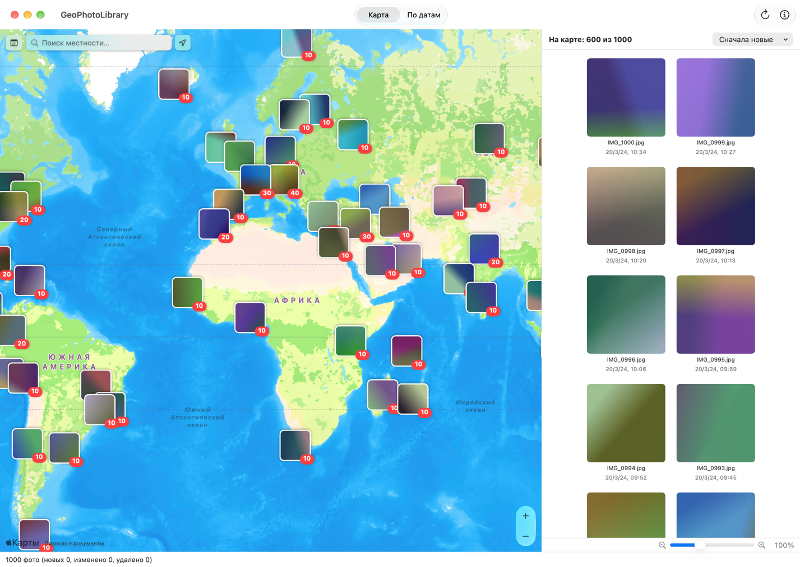
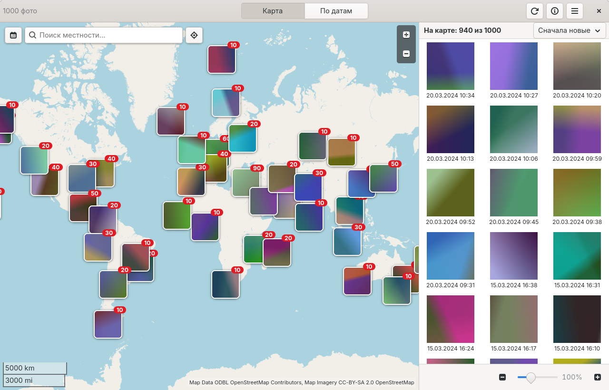
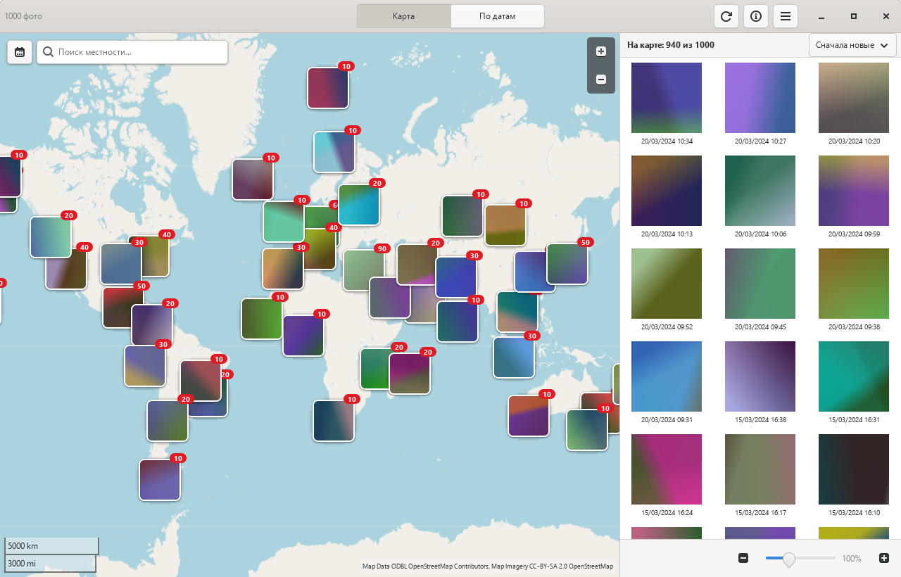

#  GeoPhotoLibrary

**Русский** | [English](README.md)

[](https://github.com/EvilX/geo-photo-library/releases/latest)
[](https://github.com/sponsors/EvilX)

Каталогизатор фотографий для Linux, Windows и macOS с поиском снимков на карте по GPS-координатам
из EXIF. Ядро на Rust (сканер, база SQLite, миниатюры) общее; интерфейс на Linux и Windows — GTK4 с
картой OpenStreetMap, на macOS — нативный, SwiftUI с картой MapKit
(см. [Сборка (macOS)](#сборка-macos)).

Версия для macOS появилась в 1.1; для Linux возможности с 1.0 не изменились.


<p align="center"><em><b>macOS</b> — нативное приложение на SwiftUI с картами Apple</em></p>


<p align="center"><em><b>Linux</b> — GTK4 и карта OpenStreetMap</em></p>


<p align="center"><em><b>Windows</b> — тот же интерфейс GTK4</em></p>

## Возможности

Описание ниже — для Linux; отличия версии для macOS перечислены в разделе
[Сборка (macOS)](#сборка-macos).

- **Карта** — превью фотографий на карте с кластеризацией; справа — фото из видимой области,
  по дате (сначала новые или сначала старые, выбор запоминается). Положение и масштаб карты
  запоминаются между запусками.
- **Поиск местности** — строка над картой: название города, адреса или достопримечательности,
  Enter — перейти (геокодер Nominatim, нужен интернет). Несколько совпадений — список на выбор.
- **Моё местоположение** — кнопка рядом со строкой поиска: карта переходит к текущему
  местоположению и отмечает его точкой (через портал геолокации; службы геолокации должны быть
  включены в настройках системы).
- **Фильтр по датам** — кнопка с календарём слева от строки поиска: над картой открывается
  панель «Всё время» и дерево год → месяц → день; на карте остаются фото выбранного периода,
  положение и масштаб карты не меняются. Выбранный период виден на кнопке; щелчок по карте
  закрывает панель.
- **По датам** — дерево год → месяц → день и сетка миниатюр. Список над деревом показывает
  все фото и видео, только фото с координатами GPS, только фото без них или только видео.
- **Информация** — панель справа с данными файла и EXIF: камера, объектив, выдержка, диафрагма,
  ISO, фокусное расстояние, координаты, высота и все теги. Следует за выбранным фото;
  при нескольких выделенных панель пуста.
  Открывается кнопкой «i» в заголовке окна или пунктом меню фото, закрывается той же кнопкой
  или крестиком.
- **Меню фото** (правая кнопка): копировать файл, просмотр, редактирование, показать на диске
  (файловый менеджер открывает папку и выделяет файл), информация,
  найти на карте (переход к месту съёмки; если в EXIF нет координат — предупреждение),
  редактировать EXIF, удалить в корзину (после подтверждения).
- **Редактирование EXIF** — окно с двумя вкладками. **Координаты:** карта с меткой, закреплённой в её центре: двигайте карту,
  щёлкните по месту (карта сдвинется к нему), найдите местность или нажмите «Моё местоположение»;
  поля широты и долготы следуют за меткой, в них можно и ввести координаты (вставленная пара
  «широта, долгота» разбирается). Для одного фото поля заполнены его координатами, для нескольких —
  пустые, а на кнопке «Сохранить» — число фото. Координаты записываются в EXIF файла (JPEG, HEIC
  и WebP; остальной EXIF сохраняется). Замена прежних координат и сохранение для нескольких фото —
  после подтверждения. **EXIF:** все теги фото с фильтром по имени или значению тега по мере ввода; править можно текст, числа
  и дроби (`1/250`, `2.8`), пустое поле удаляет тег, частые теги (описание, автор, авторские права,
  даты) можно добавить. Для нескольких фото тег с разными значениями показан как «Разные значения».
  Записываются только изменённые теги — остальной EXIF у каждого фото свой. Новая дата или
  ориентация сразу видны в дереве дат и на миниатюре.
- **Выделение нескольких фото:** Ctrl + щелчок (на macOS — ⌘ + щелчок) добавляет или снимает фото,
  Shift + щелчок выделяет диапазон, рамка мышью — фото под ней, Ctrl+A (⌘A) — все.
  Над несколькими фото меню предлагает только «Копировать», «Редактировать EXIF» и «Удалить».
- **Клавиатура в списке фото:** стрелки, Page Up/Page Down, Home/End переходят между фото,
  с Shift — расширяют выделение. В Linux и Windows: Ctrl+C — копировать, Delete — в корзину,
  Menu или Shift+F10 — меню фото, F5 — пересканировать библиотеку.
- Двойной щелчок — просмотр, Ctrl + двойной щелчок — редактирование. Просмотрщик и редактор
  выбираются в настройках (по умолчанию — программа для типа файла и найденный графический редактор).
- Под сетками фото — слайдер размера миниатюр от 50 до 200% с кнопками «−»/«+» (шаг 10%).
- При запуске библиотека инкрементально пересканируется (новые, изменённые, удалённые файлы).
- **Проверка обновлений:** при запуске программа спрашивает GitHub о последнем выпуске
  (`api.github.com`); если он новее, над вкладками появляется полоса с номером версии и ссылкой
  на [сайт](https://evilx.github.io/geo-photo-library/). Отключается в настройках
  («Проверять обновления при запуске»).
- Форматы: JPEG, HEIC/HEIF (iPhone, Samsung), PNG, WebP, TIFF, DNG (только метаданные).
- **Видео** (MP4, MOV, M4V, 3GP, MKV, WebM, AVI, MTS): видны по датам (из контейнера MP4/QuickTime,
  иначе — время файла), на миниатюре — значок ▶ и длительность; координат у видео нет, на карте их
  нет. Открываются в системном проигрывателе. Миниатюра — кадр из начала видео: на macOS его делает
  система, на Linux и Windows — программа `ffmpeg`; без неё вместо миниатюры значок (после установки ffmpeg
  миниатюры появятся при следующем сканировании).
- Языки интерфейса: английский, русский, греческий — по локали системы (`LANG`, `LC_MESSAGES`,
  `LANGUAGE`), по умолчанию английский. Даты под фото — в формате системной локали дат
  (`LC_TIME`): например, `12/21/2025 01:03 PM` в en_US и `21.12.2025 13:03` в ru_RU.

## Установка

Удобнее всего — из репозитория пакетов: тогда новые версии приходят с обычным обновлением системы.

Fedora 45 (x86_64 и aarch64):

```sh
sudo dnf config-manager addrepo --from-repofile=https://evilx.github.io/geo-photo-library/geo-photo-library.repo
sudo dnf install geo-photo-library
```

Ubuntu 24.04 и 26.04 (amd64 и arm64):

```sh
sudo install -d /etc/apt/keyrings
curl -fsSL https://evilx.github.io/geo-photo-library/key.gpg | sudo tee /etc/apt/keyrings/geo-photo-library.gpg > /dev/null
echo "deb [signed-by=/etc/apt/keyrings/geo-photo-library.gpg] https://evilx.github.io/geo-photo-library/deb $(. /etc/os-release && echo $VERSION_CODENAME) main" \
  | sudo tee /etc/apt/sources.list.d/geo-photo-library.list
sudo apt update && sudo apt install geo-photo-library
```

Те же пакеты можно скачать и поставить вручную — они в [последнем релизе](https://github.com/EvilX/geo-photo-library/releases/latest):
RPM для Fedora 45 (x86_64 и aarch64), DEB для Ubuntu 24.04 и 26.04 (amd64 и arm64), образ
диска для macOS и установщики для Windows.

```sh
sudo dnf install ./geo-photo-library-*.fc45.*.rpm                # Fedora
sudo apt install ./geo-photo-library_*~ubuntu24.04_amd64.deb     # Ubuntu: свой выпуск и архитектура
```

Сборки из текущего `main` GitHub Actions делает при каждом push: вкладка **Actions** →
последний прогон **CI** → артефакт `geo-photo-library-fc45-rpm` (x86_64),
`geo-photo-library-fc45-aarch64-rpm` (ARM), `geo-photo-library-ubuntu<выпуск>-<архитектура>-deb`, `geo-photo-library-macos-dmg` или `geo-photo-library-windows-<x64|arm64>`
(скачивание артефактов доступно только после входа в GitHub).

Образ диска для macOS — для Apple silicon, macOS 14 и новее. Приложение не подписано
сертификатом разработчика и не нотаризовано, поэтому после перетаскивания в «Программы» снимите карантин, иначе macOS
откажется его открыть:

```sh
xattr -dr com.apple.quarantine "/Applications/GeoPhotoLibrary.app"
```

Windows 10 (1809) или 11, x64 или ARM64: запустите `GeoPhotoLibrary-<версия>-<x64|arm64>-setup.exe`
из релиза. Он ставит программу для текущего пользователя, без прав администратора, и добавляет её
в меню «Пуск»; удаляется она в «Параметры» → «Приложения». Установщик не подписан, поэтому
SmartScreen может о нём предупредить: **Подробнее → Выполнить в любом случае**. Рядом лежит `.zip` —
переносная версия: распакуйте куда угодно и запустите `bin\geo-photo-library.exe`.

## Сборка (Fedora)

```sh
sudo dnf install gcc gtk4-devel libshumate-devel libheif-devel
cargo run --release
```

Без HEIC: `cargo build --release --no-default-features`.

Сканирование без GUI: `geo-photo-library --scan <папка>`.

Пакеты:

- `./packaging/build-rpm.sh` — RPM в `target/rpmbuild/RPMS/<архитектура>/`;
- `./packaging/build-deb.sh` — DEB в `target/deb/` (в Ubuntu: нужны `libgtk-4-dev libshumate-dev
  libsoup-3.0-dev libheif-dev dpkg-dev desktop-file-utils appstream` и Rust из rustup);
- `./packaging/flatpak/build-flatpak.sh` — Flatpak-бандл `target/flatpak/geo-photo-library.flatpak`
  (SDK ставится в пользовательскую установку, root не нужен).

## Сборка (Windows)

Тот же интерфейс GTK, сборка — в [MSYS2](https://www.msys2.org/): оболочка UCRT64 для x64,
CLANGARM64 для ARM64. Поставьте пакеты (`P=mingw-w64-ucrt-x86_64` или `mingw-w64-clang-aarch64`)
и запустите скрипт сборки; для установщика нужен ещё [Inno Setup](https://jrsoftware.org/isinfo.php):

```sh
pacman -S zip $P-toolchain $P-rust $P-pkgconf $P-gtk4 $P-libshumate $P-libheif $P-libsoup3 \
  $P-glib-networking $P-librsvg $P-ntldd
./packaging/windows/build-windows.sh   # → target/windows/GeoPhotoLibrary-<версия>-<арх>-setup.exe и .zip
```

Скрипт кладёт программу вместе с нужными ей библиотеками GTK, значками и модулями в
`target/windows/GeoPhotoLibrary/`, поэтому она работает без MSYS2. Отличия от Linux:

- нет кнопки «Моё местоположение» (она работает через портал геолокации Linux);
- язык интерфейса и формат дат — из настроек Windows (`LANG` по-прежнему задаёт язык);
- редактирование (Ctrl + двойной щелчок) открывает системное окно «Открыть с помощью», если
  редактор не выбран в настройках.

## Сборка (macOS)

Нативное приложение: ядро на Rust (сканер, база, миниатюры) собирается в статическую
библиотеку, интерфейс — на SwiftUI с картой MapKit (`macos/`). Нужны macOS 14 или новее,
Xcode с принятой лицензией (`sudo xcodebuild -license accept`) и Rust (rustup);
GTK и libheif не нужны — HEIC декодирует система.

```sh
./macos/build-app.sh --run   # → target/macos/GeoPhotoLibrary.app
./macos/build-dmg.sh         # → target/macos/GeoPhotoLibrary-<версия>-arm64.dmg
```

Возможности те же, что на Linux, с отличиями, принятыми в macOS:

- карта и поиск местности — Apple (MapKit), а не OpenStreetMap и Nominatim;
- «Моё местоположение» — через CoreLocation; при первом нажатии система спросит разрешение;
- меню «Правка» — действия с выбранными фото: скопировать (⌘C), удалить (⌘⌫), выделить все (⌘A),
  а для одного фото — ещё просмотр (⌘O), редактирование (⌘E), показать в Finder;
- панель «Информация» — кнопка «i» в заголовке окна или ⌘I; пересканировать — ⌘R; вкладки — ⌘1 и ⌘2;
- редактирование — ⌘ + двойной щелчок; в меню фото есть ещё «Показать в Finder»;
- настройки (⌘,) применяются сразу; просмотрщик и редактор выбираются из установленных программ;
- язык интерфейса и формат дат — из системных настроек;
- просмотр открывается двойным щелчком (Enter в сетке фото не работает);
- ширина панелей между запусками не запоминается.

## Данные

| Что | Где |
| --- | --- |
| Настройки (папка библиотеки, сортировка, масштаб миниатюр, положение карты, программы) | `~/.config/geo-photo-library/config.toml` |
| База | `~/.local/share/geo-photo-library/library.db` |
| Миниатюры | `~/.cache/geo-photo-library/thumbs/` |

Версия из Flatpak хранит те же файлы отдельно, в `~/.var/app/io.github.EvilX.GeoPhotoLibrary/`.
На macOS настройки и база лежат в `~/Library/Application Support/geo-photo-library/`,
миниатюры — в `~/Library/Caches/geo-photo-library/thumbs/`. На Windows всё лежит в
`%LOCALAPPDATA%\geo-photo-library\` (`config.toml`, `library.db`, `thumbs\`).

Сеть нужна только для тайлов карты OpenStreetMap и поиска местности; фотографии никуда
не отправляются. Местоположение определяется системой (GeoClue) только по нажатию кнопки
и никуда не сохраняется.

## Разработка

- CI (`.github/workflows/ci.yml`): clippy и тесты, затем сборка RPM для x86_64 и aarch64 — в контейнере `fedora:45`,
  и DEB для Ubuntu 24.04 и 26.04 (amd64 и arm64) — в контейнерах этих выпусков;
  на macOS — тесты ядра и сборка DMG; на Windows (x64 и ARM64, MSYS2) — тесты, установщик и ZIP.
  На теге `v*` пакеты, DMG и установщики Windows прикладываются к релизу GitHub,
  а RPM и DEB добавляются в репозитории dnf и apt на GitHub Pages (`packaging/build-repo.sh`).
- `GEO_PHOTO_LIBRARY_TRACE=1` — замеры времени операций интерфейса.
- `cargo run --release --example bench_thumbs -- <папка>` — бенчмарк генерации миниатюр.
- Инструкции для ИИ-агентов и отладочные переменные окружения — в [AGENTS.md](AGENTS.md).

## Лицензия

Copyright 2026 Leonid Nasedkin.

Распространяется по лицензии [Apache 2.0](LICENSE).
